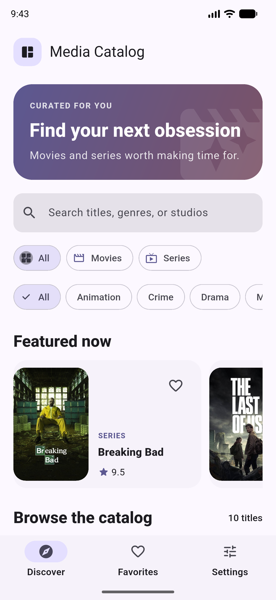
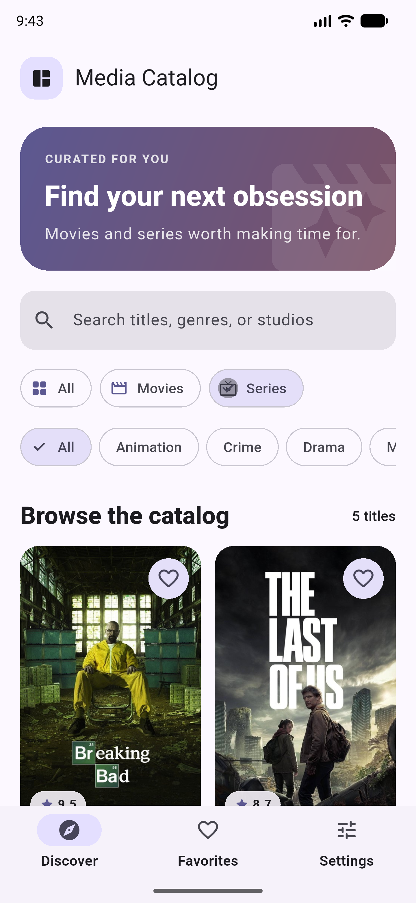
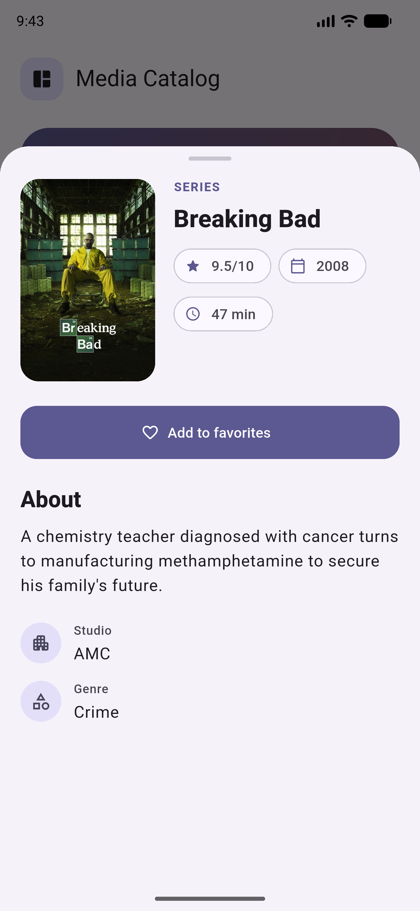

# Media Catalog

Portfolio-grade movie and series discovery built as a modular ASP.NET MVC monolith with a Flutter client.

## Features

- Seeded catalog with real movies and series and remotely loaded poster artwork
- Search by title, genre, or studio
- Filters for movies, series, and genres
- Rich detail sheets with rating, release year, runtime, genre, and studio
- Favorites persisted on the device
- English and Brazilian Portuguese
- System, light, and dark theme modes

## Technology

- ASP.NET MVC 5 and ASP.NET Web API 2 on .NET Framework 4.8
- Entity Framework 6 and SQL Server LocalDB
- Flutter with feature-first Clean Architecture
- Cubit, GetIt + Injectable, Dio, GoRouter, SharedPreferences, and ARB localization

## Repository layout

```text
src/
  backend/  ASP.NET MVC modular monolith and versioned catalog API
  mobile/   Flutter application
```

## Screenshots

| Discover | Series filter | Details |
| --- | --- | --- |
|  |  |  |

## Local setup

### Backend

1. Open `MediaCatalog.sln` in Visual Studio.
2. Restore NuGet packages.
3. Run `MediaCatalog.Backend` with IIS Express.

LocalDB is the default development database. Entity Framework creates and seeds it on first use.

### Mobile

```bash
cd src/mobile
flutter pub get
dart run build_runner build
flutter gen-l10n
flutter run --dart-define=API_BASE_URL=http://localhost:59610/api/v1
```

For an Android emulator, map the backend port with `adb reverse tcp:59610 tcp:59610` or use the host alias `10.0.2.2`.

## Validation

```bash
flutter test
flutter analyze
```

All source code, identifiers, files, folders, and documentation use English.

Poster images are delivered by TMDB. This project is not endorsed or certified by TMDB.
